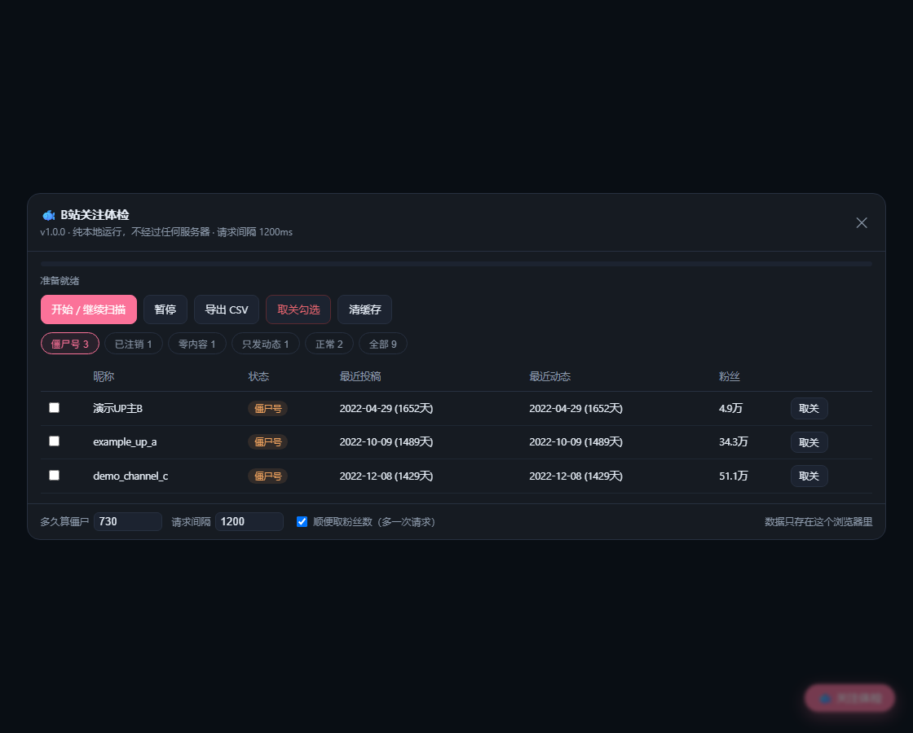

# B站关注体检 · Follow Doctor

扫一遍你的 B站 关注列表，标出**已注销**和**长期没动静**的僵尸 UP。
三种形态，都只走本机网络、不经过任何第三方服务器。

| 形态 | 适合谁 | 入口 |
|---|---|---|
| 🐟 **油猴脚本** | 一般用户，装完就能用 | [`bili-follow-doctor.user.js`](bili-follow-doctor.user.js) |
| 🔌 **DSH 插件** | 用 DeepSeek Harness 的人 | [`dsh-plugin/`](dsh-plugin/) |
| 💻 **命令行** | 想跑在服务器/批量处理 | [`cli/`](cli/) |



## 它做什么

1. 拉你的完整关注列表
2. 逐个查**最近一条投稿**和**最近一条动态**
3. 按「视频和动态都超过 N 天没更新」判定僵尸号（N 可自己设，默认 730 天）
4. 出名单（CSV / Markdown / 表格），你确认后再取关

## 判定口径

| 状态 | 含义 |
|---|---|
| 已注销 | 昵称是「账号已注销」，或主页接口 404 |
| 僵尸号 | 最近投稿**和**最近动态都超过阈值天数 |
| 只发动态 | 视频停更但动态在更新 —— **别误删** |
| 零内容 | 投稿、动态都没有 |
| 正常 | 还有更新 |

只按投稿算会误杀一大批"只发动态"的 UP（实测 121 个"停更"里有 26 个还在更新动态），所以动态必须一起查。

## 安装油猴脚本

1. 浏览器装 [Tampermonkey](https://www.tampermonkey.net/) 或 Violentmonkey
2. 打开这个地址安装（会弹安装页）：

```
https://raw.githubusercontent.com/oTAKUBANG1/bili-follow-doctor/main/bili-follow-doctor.user.js
```

3. 打开任意 B站 页面，右下角出现「🐟 关注体检」

## 命令行

```bash
cd cli
python audit.py --days 730          # 扫最近投稿（可中断续跑）
python dynamics_audit.py --days 730 # 补查动态，剔除误判
python unfollow.py --report out/follow_final_xxx.csv --status "2年无任何更新"  # dry-run
```

取关默认 dry-run，必须 `--yes` 才真执行。详见 [`cli/README.md`](cli/README.md)。

## DSH 插件

```bash
dsh plugin --profile web add link:$(pwd)/dsh-plugin
```

注册 7 个工具（登录 / 扫描 / 列名单 / 报表 / 取关 / 状态）。详见 [`dsh-plugin/README.md`](dsh-plugin/README.md)。

## 隐私

- 没有任何自建服务器、统计、埋点；只请求 `api.bilibili.com`、`app.bilibili.com`
- 油猴脚本不读 `SESSDATA`，只取 `DedeUserID`（算 mid）和 `bili_jct`（取关要 csrf）
- 扫描结果只存在本机（localStorage 或 `~/.dsh/bili-follow/`）
- 仓库里不放任何真实账号、关注名单、本机路径

细节和发布前自查清单见 [SECURITY.md](SECURITY.md)。

## 已知限制

1. 只看投稿视频 + 动态，不看专栏、直播、收藏夹；纯直播 UP 会被算成僵尸。
2. B站 风控：web 的 `arc/search` 约 60~80 次请求就被 412，所以最近投稿走 app 通道（`x/v2/space/archive`，appkey 签名）。
3. 取关不可撤销，批量前请先看 dry-run 名单。
4. 接口随时可能变；失效时先看错误码。

## License

MIT
