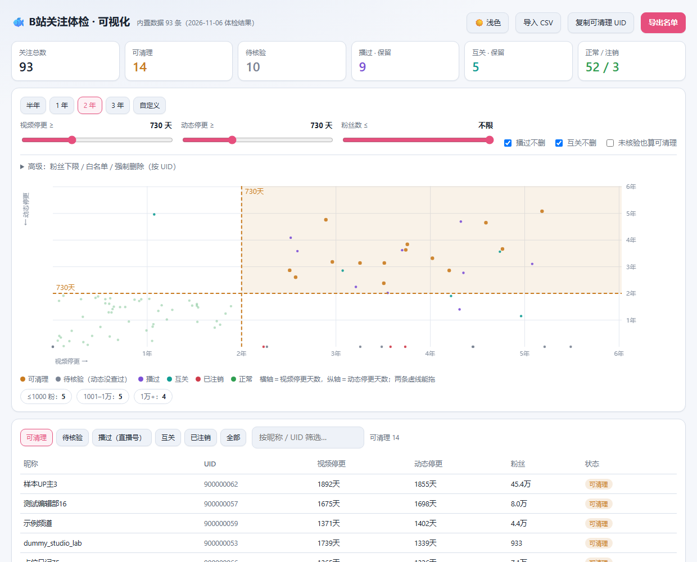

# 可视化仪表盘

一张图看清「阈值调到多少，能清掉几个」。纯前端、单文件、离线可用。



打开 `index.html` 即可（双击就行，不需要服务器）。里面内置的是**虚构演示数据**（93 条），
没有真实账号；换成你自己的数据看下面。

## 为什么要有它

命令行只能给你一个固定阈值的结果，这个能让你**拖动阈值看代价**：

- 阈值 365 天 → 可清理 49 个
- 阈值 730 天 → 可清理 36 个
- 阈值 1095 天 → 可清理 24 个

拖动两根虚线，数字和名单实时重算。

## 功能

| 功能 | 说明 |
|---|---|
| 双阈值 | 视频停更、动态停更分开设，两条虚线都能拖 |
| 预设 | 半年 / 1 年 / 2 年 / 3 年一键切 |
| 粉丝上下限 | 上限「1 万以上不自动删」，下限「只看小号」 |
| 保护开关 | 播过的主播、互相关注的，可开关是否参与清理 |
| 待核验 | 动态没查过的账号单独一桶，默认**不算**可清理 |
| 白名单 / 强制删除 | 按 UID 填，白名单永不删 |
| 分类视图 | 可清理 / 待核验 / 播过 / 互关 / 已注销 / 全部 |
| 导出 | 导出带 UID 的 CSV，或一键复制 UID 列表 |
| 主题 | 深色 / 浅色切换，记住选择，跟随系统 |

## 用自己的数据

1. 跑完体检，拿到 `cli/out/follow_live_*.csv`
2. 转成仪表盘数据：

```bash
node build-data.js /path/to/follow_live_xxx.csv data.json
```

3. 把 `tpl.html` 里的 `__DATA__` 换成 `data.json` 的内容，存成 `index.html`：

```bash
node -e "const fs=require('fs');fs.writeFileSync('index.html',fs.readFileSync('tpl.html','utf8').replace('__DATA__',fs.readFileSync('data.json','utf8')))"
```

4. 打开 `index.html`

也可以不转换，直接在页面里点「导入 CSV」选你的报表（字段要含 UID / 昵称 / 最近投稿 / 最近动态 / 粉丝数 / 直播状态 / 互关）。

## 判定口径

```
可清理 = 视频停更 ≥ V 天
       且 动态停更 ≥ D 天
       且 粉丝在 [下限, 上限] 内
       且 不是互关（开关打开时）
       且 没播过（开关打开时）
```

动态没查过的账号落到「待核验」，勾上「未核验也算可清理」才会进名单。

## 隐私

`index.html` 里的演示数据是脚本随机生成的，UID 从 `900000001` 开始，名字是「示例 / 演示 / dummy」
这类虚构词。仓库里**没有任何真实账号**。用自己的数据时，结果只留在本机浏览器里。
